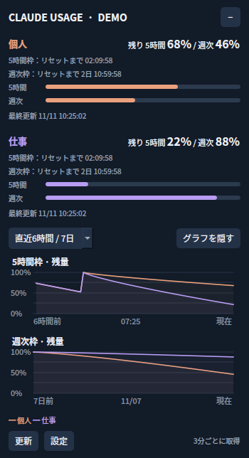

# Claude Usage Monitor

Claude（Pro / Max）の利用枠の残りを、Windows の画面の右下とタスクトレイに出す常駐アプリです。Claude Code の `/usage` と同じ「5時間枠」と「週次枠」を表示します。



- 5時間枠と週次枠の残り（%）と、リセットまでの時間
- 残りの推移のグラフ（6時間・24時間・7日）
- タスクトレイのアイコンに残量のバー（アカウントごとに、2つの枠の小さいほう）
- 残りが 10% 以下になったら Windows の通知
- 複数アカウント（Claude Code の設定フォルダを分けている場合）
- 最前面表示、透明度、ドラッグで移動、Windows ログイン時の自動起動

対象: Windows 11（Windows 10 でも動くはずですが未確認）。

## しくみと注意

- Claude Code がログイン時に保存する `%USERPROFILE%\.claude\.credentials.json` からアクセストークンを**読むだけ**です。書き換えや更新はしません。トークンが期限切れになったら、Claude Code を一度使えば Claude Code が自動で更新します。
- トークンを送る先は `https://api.anthropic.com/api/oauth/usage` だけです（Claude Code の `/usage` と同じ取得先）。ほかのサーバーには何も送りません。
- この取得先は**公開された API ではありません**。予告なく変わったり使えなくなったりすることがあります。
- 取得は 3 分ごと（アカウントごと）。取得先は短い間隔の連続取得を断るので、断られたときは間隔を広げて再試行します。
- 保存するのは残量の割合と時刻だけで、場所は `%LOCALAPPDATA%\ClaudeUsageMonitor\`（`preferences.json` と `history.sqlite3`）。トークンは保存しません。

## 必要なもの

- Claude Code（ログイン済み。`claude` を起動して `/usage` が見られる状態）
- Python 3.12（ビルドするときだけ）: `winget install Python.Python.3.12`

## ビルドとインストール

PowerShell で取得して、このフォルダに移動して:

```powershell
git clone https://github.com/zerokobo/claude-usage-monitor.git
cd claude-usage-monitor
```

そのあと:

```powershell
powershell -ExecutionPolicy Bypass -File .\build.ps1 -Install
```

`.venv` の作成 → 依存の導入 → テスト → `dist\ClaudeUsageMonitor\` に exe を作成 → `%LOCALAPPDATA%\Programs\ClaudeUsageMonitor\` へコピーして起動、まで行います。`-Install` を付けなければビルドだけです。

起動したら、パネルの「設定」→「Windowsログイン時に起動」にチェックを入れると、次回から自動で立ち上がります。

接続せずに見た目だけ確かめるには:

```powershell
.\.venv\Scripts\python.exe app.py --demo
```

## 複数アカウント

Claude Code は環境変数 `CLAUDE_CONFIG_DIR` で設定フォルダを分けられます。2つ目のアカウントを使っている場合は、「設定」→「アカウントを追加…」で表示名を付け、そのフォルダ（`.credentials.json` があるフォルダ）を選びます。最初のアカウントは `CLAUDE_CONFIG_DIR`、なければ `%USERPROFILE%\.claude` を読みます。

## アンインストール

1. トレイのメニューで「Windowsログイン時に起動」を外してから「終了」
2. `%LOCALAPPDATA%\Programs\ClaudeUsageMonitor\` を削除
3. 設定と履歴も消すなら `%LOCALAPPDATA%\ClaudeUsageMonitor\` を削除

## 開発

```powershell
.\.venv\Scripts\python.exe -m unittest discover -v   # 画面のテストは Qt の offscreen で動く
.\.venv\Scripts\python.exe usage.py                  # 今の残量を1回だけ表示
```

| ファイル | 中身 |
|---|---|
| `usage.py` | 取得、応答の解釈、履歴（SQLite）、通知の間引き。Qt に依存しない |
| `app.py` | パネル、グラフ、トレイ、設定（PySide6） |
| `build.ps1` | venv・テスト・PyInstaller・インストール |
| `BUILD_WITH_CLAUDE.md` | Claude Code に渡して、ビルドから起動まで任せるための指示 |

## ライセンス

MIT License（`LICENSE`）。Anthropic の公式ツールではありません。
